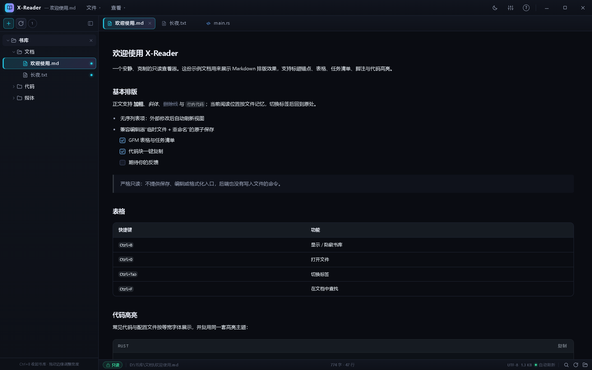
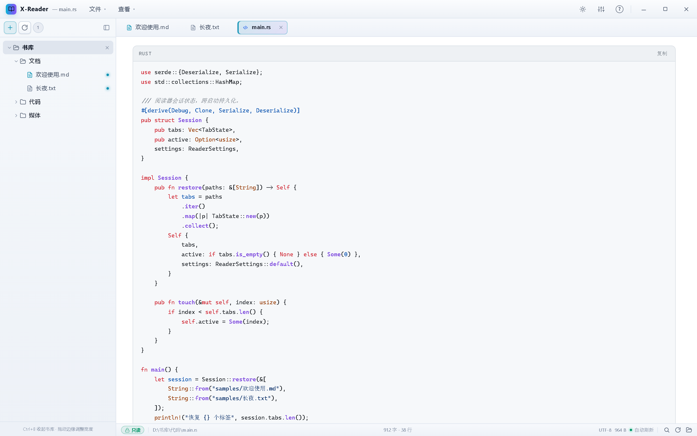
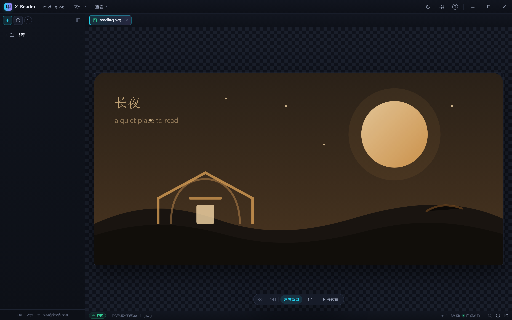

# X-Reader

一个安静、克制的 Windows 只读查看器，基于 **Tauri 2 + React + TypeScript**，支持 `.txt`、Markdown、常见代码 / 配置文件、图片、视频与音频。

## 界面预览



| 白天主题 · 代码查看 | 图片查看 |
| --- | --- |
|  |  |

## 特性

- **录音棚风格的自绘标题栏**：不显示系统标题栏；左侧是品牌与「文件 / 查看」下拉菜单，右侧是主题切换、阅读设置、快捷键速查与窗口控制。默认暗夜配色，也可切换白天或跟随系统。
- **项目栏式书库**：添加一个或多个目录作为根，逐级展开 / 折叠；目录内容按需读取。侧栏顶部是添加目录与刷新两枚图标按钮，书库数量紧邻刷新；打开文件通过标题栏「文件」菜单或 `Ctrl+O`。当前文件以青色高亮标记，侧栏可拖拽调整宽度，`Ctrl+B` 收起到图标栏，根目录与宽度会被记住。阅读设置里可以选择文件树的显示范围：常用类型、自定义后缀列表或全部文件。
- **多标签阅读**：内容区顶部是真正的标签页，同时打开文档、代码与媒体文件；中键关闭、`Ctrl+Tab` 切换、`Ctrl+1..9` 直达。
- **严格只读**：不提供保存、编辑或格式化入口，后端也没有写入文件的命令。
- **自动刷新**：监听文件所在目录，文档或媒体文件在外部被修改后自动更新视图；兼容编辑器“临时文件 + 重命名”的原子保存方式。
- **编码自动识别**：UTF-8（含 BOM）、GBK / GB18030、Big5、UTF-16 LE/BE 等常见文本编码；二进制文件会被拒绝打开。
- **代码查看**：`.go`、`.py`、`.js`、`.ts`、`.rs`、`.java`、`.json`、`.yaml` 等常见代码 / 配置文件按等宽字体展示，并复用 Markdown 的代码高亮主题（`Dockerfile`、`Makefile` 等无扩展名文件也支持）。
- **Markdown 渲染**：unified 管线 + GitHub Flavored Markdown，文档式简洁排版，支持标题锚点、表格、任务列表、删除线、脚注、代码高亮与一键复制；同目录图片通过受限的 asset 协议显示，相对链接可在新标签页打开。
- **图片查看**：常见图片格式，支持“适应窗口 / 1:1”切换并显示原始尺寸，透明背景以棋盘格呈现。
- **视频与音频**：内嵌 HTML5 播放器，支持进度拖动；媒体变化后自动重新加载，无法播放时提供“用系统应用打开”。
- **阅读体验**：暗夜 / 白天两套配色（也可跟随系统），标题栏一键切换；正文默认无衬线（可切换衬线），字号可选 10 / 12 / 14px（默认 12），版心默认占满展示区（可切换窄 / 中 / 宽 / 全宽），行高可调；阅读位置按文件记忆。
- **大文件友好**：超长文档按段落边界分块、滚动渐进渲染，避免一次性布局数兆文本。
- **细节**：最近打开列表、会话恢复、拖拽打开、窗口大小记忆、文件缺失提示、内嵌查找（高亮全部匹配）、字数 / 行数统计。

## 使用

安装包位于 `src-tauri/target/release/bundle/nsis/`（执行 `pnpm tauri build` 后生成）。

打开文件：

1. 点击左侧书库顶部的 **+**，把文件夹添加为根目录（可重复添加多个），然后在文件树中点击文档、代码、图片、视频或音频；
2. 点击欢迎页的 **打开文件**，或使用标题栏「文件 → 打开文件」（`Ctrl+O`），选择一个或多个文件；
3. 把文件直接拖入窗口；
4. 用命令行带参数启动：`x-reader.exe "D:\books\长夜.txt"`。

书库根目录只用于浏览，不会移动、修改或删除任何文件；根目录右侧的 × 只是把它从书库中移除。

### 快捷键

| 快捷键 | 功能 |
| --- | --- |
| `Ctrl+B` | 显示 / 隐藏左侧书库 |
| `Ctrl+O` | 打开文件 |
| `Ctrl+W` | 关闭当前标签 |
| `Ctrl+Tab` / `Ctrl+Shift+Tab` | 切换标签 |
| `Ctrl+1..9` | 切换到第 N 个标签 |
| `Ctrl+F` | 在文本文档中查找 |
| `Ctrl+R` / `F5` | 重新读取当前文件 |
| `Ctrl+=` / `Ctrl+-` / `Ctrl+0` | 切换字号（10 / 12 / 14px）/ 重置为 12px |
| `Esc` | 关闭查找、设置、菜单或帮助弹层 |

标题栏右侧的 **?** 按钮可以随时打开这份快捷键速查。

## 开发

环境要求：Node.js 20+、pnpm、Rust 1.85+、WebView2 Runtime（Windows 10/11 通常自带）。

```bash
pnpm install
pnpm tauri dev
```

构建安装包：

```bash
pnpm tauri build
```

仅构建可执行文件（跳过安装包）：

```bash
pnpm tauri build --no-bundle
```

## 实现说明

- `src-tauri/src/lib.rs`
  - `read_document`：读取文本 / 代码文件、识别编码、注册目录监听，并把文档目录加入 asset 协议白名单；
  - `open_media`：打开图片 / 视频 / 音频，注册文件监听并将所在目录加入 asset 协议白名单；
  - 所有命令均为异步命令并运行在阻塞线程池（`spawn_blocking`）上，大文件读取与目录扫描不会阻塞窗口事件循环，避免界面冻结或黑屏；
  - `list_directory`：按需读取一层目录，返回子目录与文件；文件按阅读设置传入的 `filter` 过滤（常用类型 / 自定义后缀 / 全部），并始终过滤隐藏 / 系统目录；
  - `notify` 目录监听 + 220ms 防抖；变更事件只携带元数据（size/mtime），前端收到后按需重新读取，且 size+mtime 未变化的触碰事件会被直接跳过；
  - 监听事件 `document-changed` 携带 `changed`（需重读文本）/ `media` / `missing` / `error` 状态与文件元数据；
  - `resolve_document_link`：解析 Markdown 相对链接并校验扩展名；
  - `take_launch_files`：处理启动参数中传入的文档。
- `src/`
  - `App.tsx`：标签页、会话恢复、自动刷新事件、快捷键、拖拽与提示；所有标签页常驻挂载（隐藏的非活动标签不参与布局与绘制），切换标签即时完成且保留各自的滚动位置；
  - `components/TitleBar.tsx`：品牌、文件 / 查看菜单、主题与阅读设置入口、快捷键速查、无边框窗口控制；
  - `components/Menu.tsx`：自绘下拉菜单（图标、快捷键提示、分组与键盘导航）；
  - `components/SettingsButton.tsx` / `components/SettingsMenu.tsx`：标题栏阅读设置弹层；
  - `components/TabBar.tsx`：内容区顶部的文档标签页与关闭按钮；
  - `components/Sidebar.tsx` / `components/FileTree.tsx`：项目栏式书库、根目录、懒加载文件树、按设置过滤文件、收起图标栏与拖拽调宽；
  - `components/WindowControls.tsx`：无边框窗口的最小化、最大化与关闭；
  - `components/Viewer.tsx`：分块窗口化渐进渲染（只保留目标位置附近的一个分块窗口，窗口之外用估算高度的占位块代替，向下滚动逐步加载、向上滚动自动补载并补偿滚动位置）、阅读位置恢复、查找、链接与锚点跳转；代码文件走等宽代码视图；
  - `components/MediaViewer.tsx`：图片适应 / 1:1 查看、视频与音频播放、媒体错误回退；
  - `components/Markdown.tsx` / `components/Code.tsx`：Markdown 与代码文件渲染（remark-gfm / rehype-slug / rehype-highlight）、标题锚点、GFM 表格与任务列表、代码高亮与复制按钮、相对图片转 asset URL；
  - `lib/format.ts`：支持的后缀清单、代码语言映射与文件类型判断；
  - `lib/storage.ts`：设置（含文件树显示范围）、书库根目录与宽度、最近打开、会话与滚动位置的本地持久化；
  - `styles.css`：深色录音棚设计系统（表面 / 描边 / 文字三级色阶、青紫强调色、紧凑控件），以及同结构的白天变体。

## 已知边界

- 文件树默认展示目录与常用类型（文本 / 代码 / 媒体）；可在阅读设置 → 文件树切换为“全部文件”或自定义后缀列表。隐藏文件和系统目录始终会被过滤；目录内容在展开时重新读取，点击刷新按钮可更新当前已展开的层级。
- “全部文件”模式下会列出所有类型，但只有文本 / 代码与媒体能预览；点击其他类型会提示暂不支持，文件本身不会被执行或修改。
- 添加的根目录必须可读；无权限或已被移动的目录会在树中显示错误与重试。
- 文本单文件上限 50 MB；超过后会拒绝打开，并停止自动刷新。媒体文件按需流式读取，不一次性载入内存。
- 视频 / 音频能否播放取决于 WebView2 自带的解码器。常见 MP4、WebM、MOV、MP3、WAV、AAC、FLAC 一般可用；MKV、AVI、WMV、APE、WMA 等会尽力打开，无法解码时点击“用系统应用打开”即可交给系统播放器。HEIC、TIFF 等图片格式同理。
- 媒体文件在外部变化时会重新加载；正在播放的视频 / 音频可能会从头开始。
- 自动刷新是“整文件重新读取”文本文档：变更通知只带元数据，内容按需在后台线程重新读取后再更新视图。编辑器写入过程中会短暂读到中间状态，防抖与重试已将这种窗口降到最小。
- `Ctrl+F` 仅用于文本文档：会高亮已渲染内容中的全部匹配并可前后跳转；若命中位于窗口之外的分块中，会自动把窗口移动到对应位置后再定位（单次最多记录 2000 个匹配）。
- 媒体显示与图片渲染依赖 Tauri asset 协议（支持 Range 请求），且只允许访问已打开文件所在的目录。

## 示例文档

`/samples` 下包含 `欢迎使用.md`、`长夜.txt` 和一张示例插图 `assets/reading.svg`，方便体验自动刷新、Markdown 排版与图片查看。

## 测试

```bash
cd src-tauri
cargo test
```

当前测试覆盖 UTF-8 / GBK / UTF-16 解码、换行归一化、二进制文件检测、文本 / 代码 / 媒体扩展名校验、Markdown 相对链接解析，以及文件树目录读取的过滤（常用 / 全部 / 自定义后缀）与排序。
